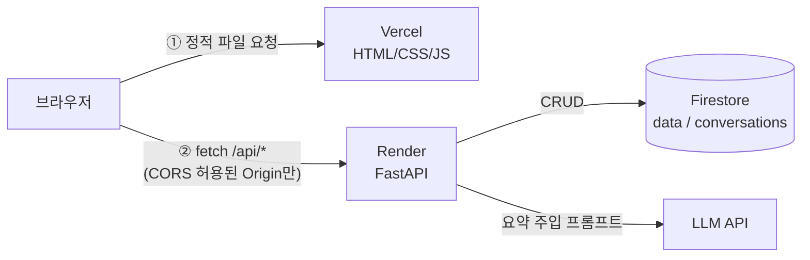
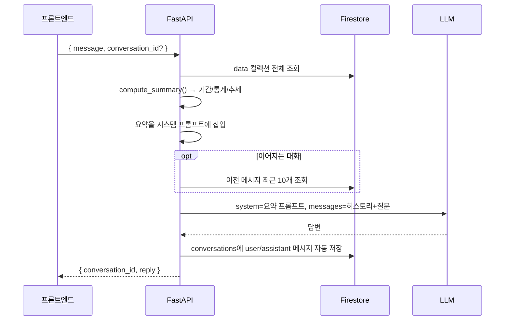

# 마라탕 트렌드 AI 비서

> 내 데이터를 알고 답하는 AI 비서 — 구글 트렌드 '마라탕' 10년치 월별 검색 관심도를 분석하고, 그 요약을 근거로 대화하는 웹 서비스

일반적인 챗봇에게 "요즘 마라탕 인기 어때?"라고 물으면 일반론만 돌아옵니다.
이 서비스는 **저장된 시계열 데이터의 요약(기간·통계·추세)을 시스템 프롬프트에 주입**해서,
"2026-09 기준 79로 최근 12개월 평균(75.5)보다 높고, 전년 동월 대비 2.5% 하락했어요"처럼 **내 데이터에 근거한 답변**을 합니다.

## 배포 URL

| 구분 | URL |
|---|---|
| 프론트엔드 (Vercel) | https://codysseym1-22.vercel.app |
| 백엔드 API (Render) | https://codyssey-m1-2-uhxh.onrender.com |
| Swagger UI | https://codyssey-m1-2-uhxh.onrender.com/docs |

> Render 무료 플랜은 15분간 요청이 없으면 서버가 잠듭니다. 첫 접속 시 최대 1분 정도 걸릴 수 있으며, 화면 상단에 "서버를 깨우는 중" 안내가 표시됩니다.

## 주요 기능

| 기능 | 내용 |
|---|---|
| 데이터 기반 AI 채팅 | 질문 → 데이터 요약을 반영한 AI 답변, 로딩 표시, 이어서 대화하기 |
| 데이터 요약 | 기간 / 개수 / 추세 / 평균·최고·최저 / 전년 동월 대비 / 관심 높은 달 |
| 데이터 관리 (CRUD) | (월, 값, 메모) 추가·수정·삭제, 같은 월 중복 방지, 변경 즉시 요약·그래프 갱신 |
| 대화 기록 | 채팅 시 자동 저장, 목록 조회, 선택한 대화 불러오기, 삭제 |
| 보너스 | 월별 추이 그래프(호버 툴팁), CSV/JSON 내보내기, 다크 모드, 추가 지표(전년 동월 대비·계절성·연도별 평균) |

## 기술 스택

| 영역 | 사용 기술 |
|---|---|
| 백엔드 | Python 3.11, FastAPI, Uvicorn, Pydantic v2, python-dotenv |
| DB | Firebase Firestore (`firebase-admin`) |
| AI | LLM API (과정 제공 API 프록시 경유) |
| 프론트엔드 | HTML / CSS / JavaScript (프레임워크·차트 라이브러리 없이 SVG로 직접 그래프 구현) |
| 배포 | Render (백엔드), Vercel (프론트엔드) |

---

## 아키텍처



- Vercel은 정적 파일만 제공하고, 실제 API 호출은 **브라우저 → Render**로 직접 갑니다.
- 그래서 Render는 `ALLOWED_ORIGINS`에 Vercel 도메인을 등록해 CORS를 허용합니다.
- 바닐라 JS는 런타임에 환경변수를 읽을 수 없으므로, Vercel 빌드 시 `build.mjs`가 `API_BASE_URL`로 `config.js`를 생성합니다.

### 채팅 흐름 (`POST /api/chat`)



## 폴더 구조

```
backend/
├── main.py                 # 앱 생성, CORS, 공통 예외 핸들러, 라우터 등록, /health
├── core/
│   ├── config.py           # 환경변수 로드 (키·모델·CORS)
│   ├── firebase.py         # Firestore 클라이언트 (첫 요청 시 지연 초기화)
│   └── errors.py           # NotFound/Conflict/... 서비스 예외 → HTTP 상태코드
├── schemas/                # Pydantic 요청/응답 모델 (입력 검증)
├── routers/                # data / conversations / chat — HTTP 입출력만 담당
├── services/               # 실제 로직
│   ├── summary_service.py  # 시계열 → 요약 (DB와 무관한 순수 함수)
│   ├── data_service.py     # data 컬렉션 CRUD
│   ├── conversation_service.py
│   └── chat_service.py     # 프롬프트 구성 + AI 호출 + 자동 저장
├── scripts/
│   ├── clean_trends.py     # 구글 트렌드 원본 CSV 정리
│   └── seed.py             # 정리된 CSV → Firestore 업로드
└── data/maratang_monthly.csv

frontend/
├── index.html / style.css / app.js / chart.js
├── config.js               # 로컬 개발용 API 주소
├── build.mjs               # Vercel 빌드: dist/ 생성 + API_BASE_URL로 config.js 작성
└── vercel.json
```

---

## 데이터

- **출처**: Google Trends, 검색어 "마라탕", 대한민국, 2015-12 ~ 2026-09 월별 (130개)
- **값의 의미**: 0~100 상대 지수. 100은 기간 중 검색량이 가장 많았던 달이며 실제 검색 횟수가 아닙니다.
  그래서 예시의 `total`(합계)은 의미가 없어 제외하고, 평균·최고·최저·추세 위주로 요약합니다.
- **전처리** (`scripts/clean_trends.py`): `2015-12-01` → `2015-12`, `<1` 같은 값은 0으로 처리, 최고점에 메모 자동 부여.

### 요약 계산 방식 (`services/summary_service.py`)

| 지표 | 계산 |
|---|---|
| 추세 | 최근 12개월 평균 vs 직전 12개월 평균. ±5% 이상이면 상승/하락, 아니면 유지. 최근 3개월 단기 변화도 함께 표시 |
| 전년 동월 대비 | 가장 최근 월 vs 1년 전 같은 월 |
| 관심 높은 달 | 최근 5년(60개월) 월별 평균 상위 3개 (관심이 거의 없던 초기 구간의 왜곡 방지) |
| 연도별 평균 / 최근 12개월 값 | 연도 비교·최근 흐름 질문에 답할 수 있도록 프롬프트에 함께 제공 |

### `GET /api/data/summary` 응답 예시 (실제 값)

```json
{
  "period": "2015-12 ~ 2026-09",
  "count": 130,
  "metrics": {
    "average": 48.7,
    "max": 100, "max_date": "2022-10",
    "min": 0, "min_date": "2016-02",
    "latest": 79, "latest_date": "2026-09",
    "recent_12m_average": 75.5,
    "prev_12m_average": 70.2,
    "yoy_change": "2025-09 81 -> 2026-09 79 (-2.5%)"
  },
  "trend": "상승 (최근 12개월 평균 75.5, 직전 12개월 대비 +7.6%, 최근 3개월 -1.9%)",
  "peak_season": "9월(81.0), 7월(78.0), 10월(76.2) (최근 5년 월별 평균 기준)",
  "yearly_average": { "2019": 56.2, "2022": 79.0, "...": "..." },
  "recent_values": [{ "date": "2025-10", "value": 88 }, "..."]
}
```

### Firestore 컬렉션

```
data/{autoId}
  date: "2026-09"        # YYYY-MM, 중복 불가
  value: 79              # 0~100
  memo: ""
  created_at, updated_at # ISO 8601

conversations/{autoId}
  title: "요즘 마라탕 인기가 어때?"   # 첫 질문 앞 30자
  messages: [{ role: "user" | "assistant", content, ts }]
  created_at, updated_at
```

## API

| Method | Endpoint | 설명 |
|---|---|---|
| GET | `/api/data` | 데이터 목록 (date 오름차순) |
| POST | `/api/data` | 데이터 추가 (같은 월이 있으면 409) |
| PUT | `/api/data/{id}` | 데이터 수정 |
| DELETE | `/api/data/{id}` | 데이터 삭제 |
| GET | `/api/data/summary` | 데이터 요약 (프롬프트 주입용) |
| POST | `/api/conversations` | 대화 저장 |
| GET | `/api/conversations` | 대화 목록 — **messages 미포함**, 최신순 (`message_count`만 제공) |
| GET | `/api/conversations/{id}` | 특정 대화의 전체 messages 조회 (대화 불러오기, 요구사항 (A) 방식) |
| DELETE | `/api/conversations/{id}` | 대화 삭제 |
| POST | `/api/chat` | AI 대화. `conversation_id`가 없으면 새 대화 생성, 있으면 이어서 저장 |
| GET | `/health` | 헬스 체크 (프론트가 콜드스타트 대비로 먼저 호출) |

에러 응답은 `{"detail": "..."}` 형식입니다. (422 입력 오류, 404 없음, 409 중복, 502 AI 호출 실패, 503 키 미설정)

---

## 로컬 실행 방법

### 1. 백엔드

```bash
cd backend
python -m venv .venv
.venv\Scripts\activate          # macOS/Linux: source .venv/bin/activate
pip install -r requirements.txt

cp .env.example .env            # 값 채우기 (아래 환경 변수 참고)
# Firebase 콘솔 > 프로젝트 설정 > 서비스 계정 > "새 비공개 키 생성"
# → backend/serviceAccountKey.json 으로 저장 (.gitignore 처리됨)

python -m scripts.seed          # Firestore에 데이터 130개 업로드 (재실행해도 중복 없음)
uvicorn main:app --reload       # http://127.0.0.1:8000/docs
```

### 2. 프론트엔드

```bash
cd frontend
python -m http.server 5500      # http://127.0.0.1:5500
```

`frontend/config.js`의 기본 API 주소가 `http://127.0.0.1:8000`이라 별도 설정 없이 로컬 백엔드에 연결됩니다.

## 환경 변수

### 백엔드 (Render / `backend/.env`)

| 변수 | 필수 | 설명 |
|---|---|---|
| `ANTHROPIC_API_KEY` | ✅ | AI API 키 |
| `ANTHROPIC_BASE_URL` | | 과정 제공 API 프록시 주소 |
| `ANTHROPIC_MODEL` | | 사용할 모델 (예: `claude-haiku-4`) |
| `ANTHROPIC_MAX_TOKENS` | | 답변 최대 토큰. 비용 제한용 (기본 500) |
| `FIREBASE_SERVICE_ACCOUNT_JSON` | ✅* | 서비스 계정 키 JSON **내용 전체** (배포용) |
| `FIREBASE_SERVICE_ACCOUNT_PATH` | ✅* | 서비스 계정 키 파일 경로 (로컬용) |
| `ALLOWED_ORIGINS` | ✅ | CORS 허용 도메인, 쉼표로 구분. 끝에 `/` 없이 |
| `CHAT_HISTORY_LIMIT` | | AI에 함께 보낼 이전 메시지 수 (기본 10) |

\* 둘 중 하나만 설정하면 됩니다. JSON이 있으면 JSON을 우선 사용합니다.

### 프론트엔드 (Vercel)

| 변수 | 설명 |
|---|---|
| `API_BASE_URL` | 백엔드 주소. 빌드 시 `config.js`에 기록되므로 **값을 바꾸면 Redeploy 필요** |

## 배포

**Render (백엔드)** — Web Service

| 항목 | 값 |
|---|---|
| Root Directory | `backend` |
| Build Command | `pip install -r requirements.txt` |
| Start Command | `uvicorn main:app --host 0.0.0.0 --port $PORT` |
| 환경 변수 | 위 백엔드 표 + `PYTHON_VERSION=3.11.9` |

**Vercel (프론트엔드)**

| 항목 | 값 |
|---|---|
| Root Directory | `frontend` |
| Framework Preset | Other (빌드 설정은 `vercel.json`: `node build.mjs` → `dist/`) |
| 환경 변수 | `API_BASE_URL=https://codyssey-m1-2-uhxh.onrender.com` |

배포 후 Render의 `ALLOWED_ORIGINS`에 Vercel 도메인을 추가해야 브라우저 요청이 허용됩니다.

---

## 설계 설명

### 1. 시계열 분석 → 요약 → 서비스 활용 흐름
원본 CSV를 정리해(`clean_trends.py`) Firestore `data` 컬렉션에 저장하고, 요청할 때마다 `compute_summary()`가 전체 데이터로 기간·통계·추세를 계산합니다.
같은 요약이 ① 화면의 요약 패널, ② `/api/data/summary`, ③ AI 시스템 프롬프트에 쓰입니다.
요약을 저장해 두지 않고 매번 계산하기 때문에, 데이터를 추가·수정하면 다음 질문부터 바로 답변에 반영됩니다. (130개라 계산 비용은 무시할 수준입니다.)

### 2. 라우터 / 서비스 분리 기준
- **routers**: HTTP만 담당합니다. 경로, 상태코드, 요청 모델을 받아 서비스로 넘기는 일만 합니다.
- **services**: 실제 로직(Firestore 접근, 요약 계산, AI 호출)을 담당합니다. HTTP를 모르기 때문에 `seed.py` 같은 스크립트에서도 재사용합니다.
- **summary_service**는 DB와도 분리된 순수 함수라서, Firestore 없이 CSV만으로 테스트할 수 있습니다.
- 서비스는 `NotFoundError` 같은 자체 예외를 던지고, `main.py`의 핸들러 한 곳에서 HTTP 응답으로 변환합니다.

### 3. Pydantic 입력 검증
DB에 잘못된 값이 들어가면 요약과 AI 답변까지 오염되기 때문에, 요청이 들어오는 시점에 막습니다.
- `date`: 정규식 `^\d{4}-(0[1-9]|1[0-2])$` (월 단위, `2026-13` 거부)
- `value`: 0 ≤ 정수 ≤ 100 (트렌드 지수 범위)
- `memo` ≤ 200자, 채팅 `message` 1~1000자이며 공백만 있는 메시지는 거부
- 검증에 실패하면 FastAPI가 자동으로 422와 실패한 필드를 응답하고, 프론트는 이를 그대로 사용자에게 보여줍니다.
- 같은 스키마를 `seed.py`에서도 사용해 업로드 데이터도 검증합니다.

### 4. Firestore CRUD
- 문서 ID는 자동 생성하고, `date`의 유일성은 `where("date", "==", ...)` 조회로 직접 보장합니다(409).
- 대화는 문서 하나에 `messages` 배열로 저장합니다. 목록 조회는 가볍게 `message_count`만 주고, 상세 조회(`GET /{id}`)에서만 전체 메시지를 돌려줍니다.

### 5. 컨텍스트 주입 (Context Injection)
LLM은 우리 데이터를 모르므로, 질문할 때마다 **요약을 시스템 프롬프트에 텍스트로 넣어** 함께 보냅니다.
130개 원본을 전부 넣는 대신 요약(통계·추세·연도별 평균·최근 12개월)만 넣어 토큰을 줄이면서도 "최고점은?", "2019년과 비교하면?" 같은 질문에 답할 수 있게 했습니다.
"0~100 상대 지수이며 실제 검색 횟수가 아니다", "데이터에 없는 원인은 추측임을 밝혀라" 같은 규칙도 넣어 잘못된 해석을 막습니다.

```
당신은 '마라탕' 검색 트렌드 데이터를 분석해 주는 데이터 분석 비서입니다.
[사용자 데이터 요약]
- 데이터 기간: 2015-12 ~ 2026-09
- 총 레코드: 130개
- 주요 지표: {"average": 48.7, "max": 100, "max_date": "2022-10", ...}
- 최근 트렌드: 상승 (최근 12개월 평균 75.5, 직전 12개월 대비 +7.6%, ...)
...
```

### 6. CORS / 환경변수 / 키 관리
- **CORS**: 프론트(Vercel)와 API(Render)의 도메인이 달라서, 브라우저는 API가 허용한 Origin일 때만 응답을 읽습니다. `*` 대신 실제 도메인만 `ALLOWED_ORIGINS`로 허용합니다.
- **환경변수**: 로컬·배포 환경마다 다른 값(키, DB, 도메인)을 코드 수정 없이 바꿀 수 있습니다.
- **키 관리**: API 키와 서비스 계정 키(DB 전체 관리자 권한)는 코드와 Git에 절대 넣지 않습니다(`.gitignore`). 배포 환경에서는 Render 환경변수에만 저장합니다.
- 키는 백엔드에만 있고 프론트엔드는 키를 모르기 때문에, 브라우저에서 키가 노출되지 않습니다.
- 처리되지 않은 예외는 로그에만 남기고, 사용자에게는 일반 메시지만 돌려줘서 내부 정보가 응답에 실리지 않게 했습니다.

### 비용 관리
- `ANTHROPIC_MAX_TOKENS=500`으로 답변 길이를 제한합니다.
- 이전 대화는 최근 10개 메시지만 보냅니다.
- 요약만 주입해 입력 토큰을 줄입니다.

### 콜드스타트 대응
- 프론트는 페이지를 열 때 `/health`를 먼저 호출해 서버를 깨웁니다.
- 요청이 3초 넘게 걸리면 안내 배너를 띄우고, 요청 타임아웃은 90초로 잡았습니다.
